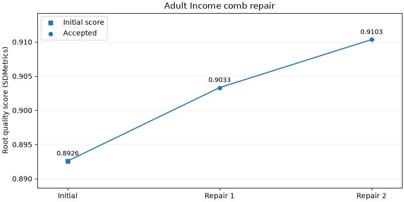
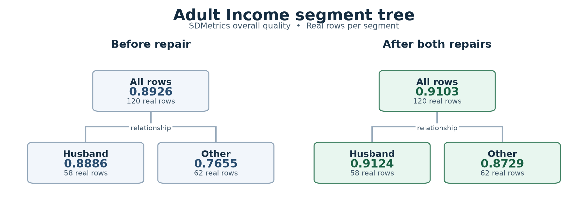

# LLM Repair for Segment-Level Synthetic Data Fidelity with Zero Real-Record Exposure

_A Roll-Up / Drill-Down Framework for Tabular Data_

LLM synthetic data repair for tabular datasets, with a runnable Adult Income
example and SDMetrics evaluation at the segment and table levels.

## Background

A synthetic table can score well overall while misrepresenting smaller groups.
The paper's method builds a segment tree from the real table, then uses a
**comb sweep** to repair the lowest-scoring leaf segments first. The LLM sees
aggregate summaries and fabricated example rows. The real rows stay local for
tree construction and scoring.

For each leaf, the LLM generates candidate rows in batches. SDMetrics scores
the accumulated rows after each batch against the target segment. The scores
inform the next prompt.
The comb sweep accepts a replacement if the overall quality score holds steady
or improves at the leaf and every ancestor up to the root. A deferred rebase
then retries rejected candidates against the updated table and accepts a
replacement only when it improves the root score.

This repository runs that method on Adult Income. It takes the starting
synthetic table as an input and uses local files for all experiment outputs.

## Run the mini Adult Income example

### 1. Install dependencies

Use Python 3.14 and uv. Run the commands from the repository root. The commands
create `output/` as needed.

```sh
uv sync --locked
```

### 2. Generate the initial synthetic CSV

Start with the bundled [real Adult Income CSV](llm_segment_repair/data/adult_income_real.csv).
Its 120 records define the target distributions. Set `OPENAI_API_KEY` in your
environment or local `.env` file, then generate a synthetic table for the whole
sample. The model receives aggregate summaries and fabricated examples.

```sh
uv run --locked python -m llm_segment_repair.run_adult_income \
  --real llm_segment_repair/data/adult_income_real.csv \
  --generate-initial \
  --model gpt-5.2 \
  --output output/adult_income_initial.csv
```

The command writes `output/adult_income_initial.csv`. This is
the starting synthetic table for the comb sweep. You can substitute a prepared
real CSV with the same twelve columns in the [Adult Income schema](llm_segment_repair/data/adult_income.json).

### 3. Run the comb sweep

Use the real CSV and the initial synthetic CSV from step 2.

```sh
uv run --locked python -m llm_segment_repair.run_adult_income \
  --real llm_segment_repair/data/adult_income_real.csv \
  --initial output/adult_income_initial.csv \
  --model gpt-5.2 \
  --output output/trajectory.csv
```

The runner samples up to 120 rows from each input using seed 42 and builds the
tree with a 30-row minimum child size. The example generates at most 120
candidate rows in batches of 50. Both commands default to GPT-5.2 with
reasoning effort `none`. Use `--model` on either command to select an OpenAI
model that supports structured outputs.

The two steps together make at most nine OpenAI requests, including requests
for missing rows. Initial generation allows four requests and the comb sweep
allows five. If the budget runs out, the runner stops before making another
request. Completed comb checkpoints stay on disk. A new model run can return different rows with the same
seed. The mini example uses a smaller sample than the archived paper result.

The run writes `output/trajectory.csv` with the accepted root score after each event.
The sibling `output/trajectory.run/` directory contains the candidate CSVs, their
manifest, iteration checkpoints, and `decisions.jsonl` with the detailed
scores and decisions.

### 4. Plot the run

```sh
uv run --locked python -m llm_segment_repair.redraw \
  --input output/trajectory.csv --output output/trajectory.pdf
```

The plot shows the initial root score and the score retained after each
repair or rebase. Filled circles mark accepted candidates and hollow circles
mark rejected candidates. The plotter reads the initial score from the
sibling run's decision log. If you used a custom run directory, pass its
`decisions.jsonl` with `--decisions`.

## Mini example results

Both repairs were accepted in this run. The root quality score rose from
**0.8926** to **0.9103**.



The tree shows the real row count and SDMetrics score for each segment before
and after repair.



## Data attribution

The real CSV adapts the Adult training data by Barry Becker and Ronny Kohavi
(1996). We binned ages, filtered small segments and incomplete rows, and sampled
120 rows with seed 42. [UCI Adult dataset](https://doi.org/10.24432/C5XW20) ·
[CC BY 4.0](https://creativecommons.org/licenses/by/4.0/)
